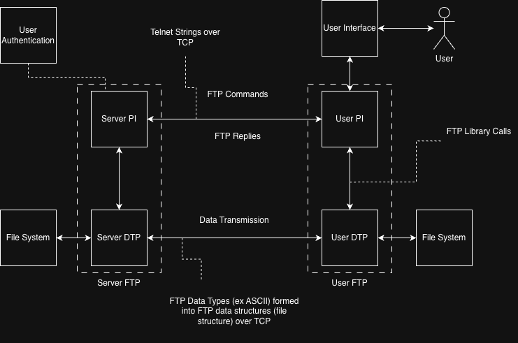
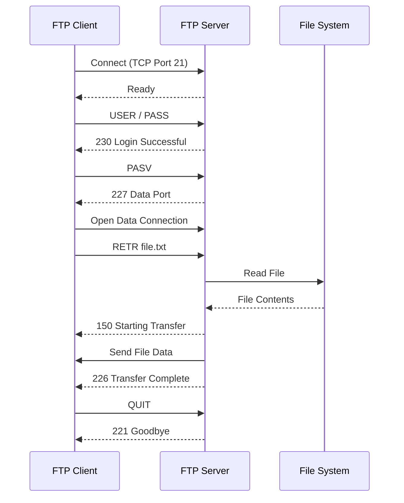

# Project Proposal Meeting Notes
- Finish up individual assigned parts of proposal
- Consider the VSCode live extension for pair programming + debugging sessions
- Gavin to setup webhooks to ping discord when certain repo events happen
- Eventually we will have CI, once we start coding stuff
- Justin to be in charge of submission tomorrow 10/8

## Block Diagram of FTP

> FTP Block Diagram with Protocols, derived from Fig. 1 in [RFC 939](https://www.rfc-editor.org/info/rfc959/)

### Sequence Diagram

> Sequence Diagram: Covering basic client-server interaction

## Methodology
- implementation steps -> see minimuim implementation in RFC, prioritize these and there larger components!